# FaceLab – Watchface-Studio für die Forerunner 970

FaceLab ist ein Studio für eigene Garmin-Watchfaces: eine Website mit 40 fertigen Designs, die du live
ansehen, anpassen und als installierbares Watchface (`.prg`) herunterladen kannst – direkt im Browser,
ohne SDK, ohne Konto, ohne Connect IQ Store.

<p align="center">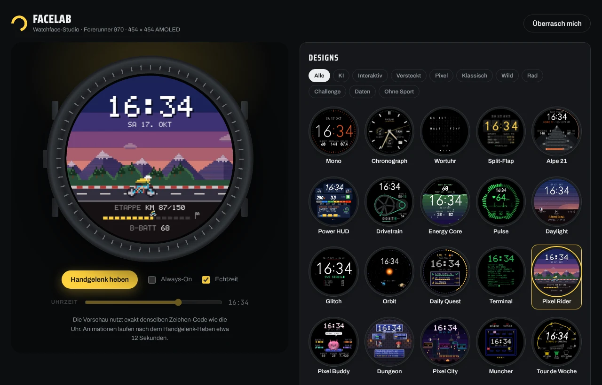</p>

## Schnellstart

1. **Studio öffnen:** `site/FaceLab.html` im Browser öffnen (Doppelklick genügt, funktioniert offline).
   Die Datei entsteht mit `node tools/bundle.mjs` (siehe unten) oder als Artefakt der GitHub Action.
2. Design wählen, Variante/Farben/Datenfelder einstellen.
3. Uhr per USB anschließen und auf **„Direkt auf die Uhr übertragen (USB)“** klicken (Chrome, Edge oder
   Brave; WebUSB, kein Zusatzprogramm nötig), Forerunner im Dialog wählen, Uhr trennen.
   Ohne Chromium-Browser: **„Watchface erzeugen (.zip)“**, ZIP entpacken und die `.prg` mit
   [OpenMTP](https://openmtp.ganeshrvel.com/) nach `GARMIN/APPS` kopieren.
4. Auf der Uhr: Watchface lange drücken → Watchface wählen → dein neues Design.

Der Name bestimmt den Platz auf der Uhr: Mit gleichem Namen neu erzeugen und die Datei ersetzen
aktualisiert das Watchface; ein neuer Name legt ein zusätzliches an. So kannst du mehrere Varianten
gleichzeitig auf der Uhr haben.

## Die Designs

Alle 40 Designs auf einen Blick (gerendert mit derselben Engine wie die Vorschau im Studio):

<p align="center">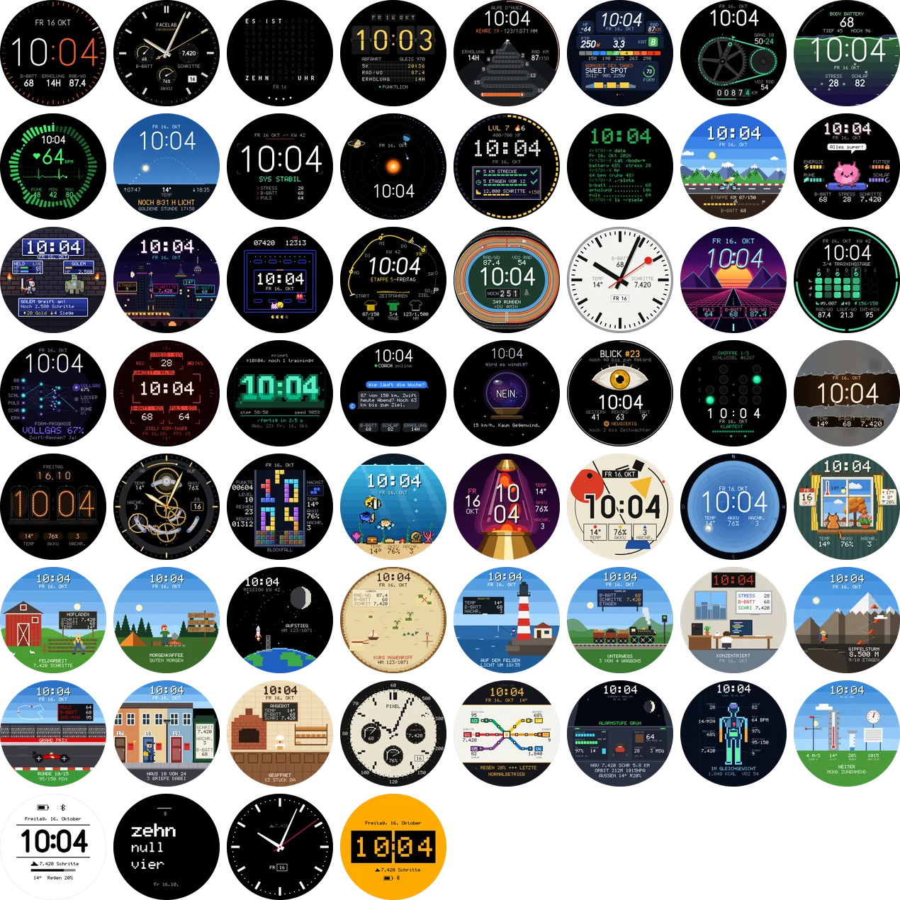</p>

Die Animationen zeigen, was beim Handgelenk-Heben passiert: Intro und die ersten Sekunden der laufenden Animation.

### Klassisch

<table>
<tr>
<td align="center" valign="top" width="25%">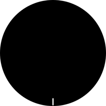<br><b>Mono</b><br><sub>Riesige Monoline-Ziffern, die sich beim Handgelenk-Heben selbst schreiben</sub></td>
<td align="center" valign="top" width="25%">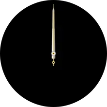<br><b>Chronograph</b><br><sub>Analoger Chronograph mit Hilfszifferblättern und gleitendem Sekundenzeiger</sub></td>
<td align="center" valign="top" width="25%">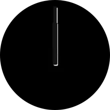<br><b>Bahnhofsuhr</b><br><sub>Roter Kellen-Sekundenzeiger: 58,5 s Umlauf, Halt bei 12, Minutensprung</sub></td>
<td align="center" valign="top" width="25%"><br><b>Wortuhr</b><br><sub>„ES IST VIERTEL NACH ZEHN“ – deutsche Wortuhr</sub></td>
</tr>
<tr>
<td align="center" valign="top" width="25%">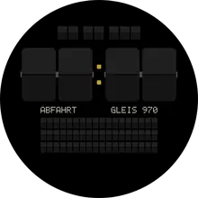<br><b>Split-Flap</b><br><sub>Bahnhofs-Klapptafel, die sich durchblättert</sub></td>
<td align="center" valign="top" width="25%">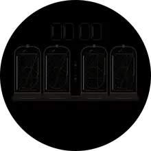<br><b>Nixie</b><br><sub>Glühende Nixie-Röhren, die beim Heben alle Ziffern durchlaufen; Dekatron-Variante mit Sekunden-Glimmpunkt</sub></td>
<td align="center" valign="top" width="25%">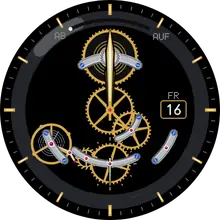<br><b>Skelett</b><br><sub>Offenes Uhrwerk mit schwingender Unruh, Räderwerk und Tourbillon; Gangreserve = Akku</sub></td>
<td align="center" valign="top" width="25%">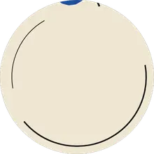<br><b>Bauhaus</b><br><sub>Kreis, Quadrat, Dreieck: Stunde und Minute als Formen, jede Minute neu komponiert (auch Mondrian, Memphis)</sub></td>
</tr>
</table>

### Rad & Training

<table>
<tr>
<td align="center" valign="top" width="25%">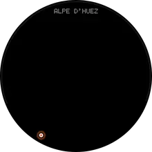<br><b>Alpe 21</b><br><sub>21 Kehren der Alpe d'Huez (oder Ventoux, Stelvio, Everest) – Antrieb wählbar: Höhenmeter, Rad-km-Wochenziel oder Trainingstage</sub></td>
<td align="center" valign="top" width="25%">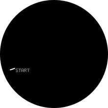<br><b>Tour de Woche</b><br><sub>Die Woche als Rundfahrt: 7 Etappen, Gelbes (Rad-km), Grünes (Trainingstage) und Bergtrikot (Höhenmeter)</sub></td>
<td align="center" valign="top" width="25%">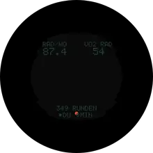<br><b>Velodrom</b><br><sub>Wochen-km als Runden auf der 250-m-Bahn, Rundentafel und Zielglocke</sub></td>
<td align="center" valign="top" width="25%">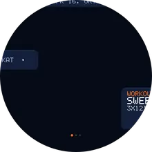<br><b>Power HUD</b><br><sub>Zwift-inspiriert: FTP, W/kg, Kategorie, Zonen in Watt, Workout des Tages</sub></td>
</tr>
<tr>
<td align="center" valign="top" width="25%">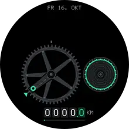<br><b>Drivetrain</b><br><sub>Kettenblatt und Kassette als Uhr – jede Stunde ein Ritzel weiter</sub></td>
<td align="center" valign="top" width="25%">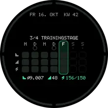<br><b>Wochenbilanz</b><br><sub>Heatmap der Woche, Trainingstage als Ring</sub></td>
</tr>
</table>

### Pixel-Art

<table>
<tr>
<td align="center" valign="top" width="25%">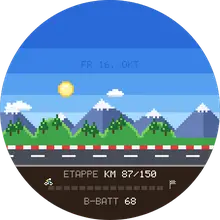<br><b>Pixel Rider</b><br><sub>8-Bit-Sidescroller mit Parallax, echter Tag/Nacht-Himmel, Etappenziel mit Zielbanner</sub></td>
<td align="center" valign="top" width="25%">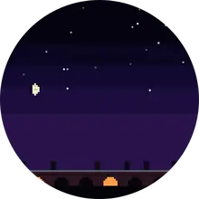<br><b>Pixel City</b><br><sub>Skyline, in der jede erklommene Etage ein Fenster erleuchtet; S-Bahn, Regen, Schnee</sub></td>
<td align="center" valign="top" width="25%">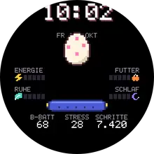<br><b>Pixel Buddy</b><br><sub>Tamagotchi, das auf Body Battery, Stress, Schritte und Schlaf reagiert</sub></td>
<td align="center" valign="top" width="25%"><br><b>Dungeon</b><br><sub>Täglich ein neues Monster – deine Schritte sind die Angriffe, Gold und Sieg-Serie</sub></td>
</tr>
<tr>
<td align="center" valign="top" width="25%">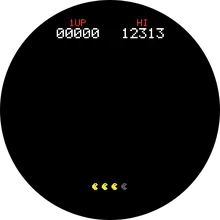<br><b>Muncher</b><br><sub>Arcade-Labyrinth: frisst deine Schritt-Punkte, Stress bringt Geister</sub></td>
<td align="center" valign="top" width="25%">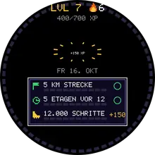<br><b>Daily Quest</b><br><sub>Drei tägliche Quests, XP, Level und Streak</sub></td>
<td align="center" valign="top" width="25%">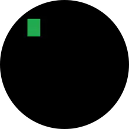<br><b>Terminal</b><br><sub>Grüner Phosphor, Shell-Session mit deinen Körperdaten</sub></td>
<td align="center" valign="top" width="25%">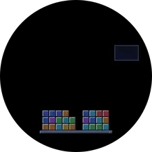<br><b>Blockfall</b><br><sub>Fallende Blöcke stapeln sich zur Uhrzeit, Reihen werden abgeräumt, Rekord wird gespeichert</sub></td>
</tr>
<tr>
<td align="center" valign="top" width="25%"><br><b>Aquarium</b><br><sub>Riff, Koi-Teich oder Tiefsee; nachts dunkel, beim Heben kommen die Fische an die Scheibe</sub></td>
<td align="center" valign="top" width="25%">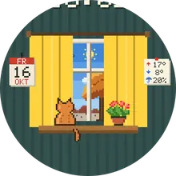<br><b>Wetterfenster</b><br><sub>Pixel-Fenster mit dem echten Wetter: Regen an der Scheibe, Schnee auf dem Sims, Katze, Postkarte, Diorama</sub></td>
</tr>
</table>

### KI, interaktiv & versteckte Uhrzeit

<table>
<tr>
<td align="center" valign="top" width="25%">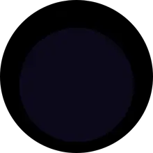<br><b>Neuronetz</b><br><sub>Körperdaten als Eingänge eines neuronalen Netzes, Signale pulsieren bis zur Uhrzeit</sub></td>
<td align="center" valign="top" width="25%">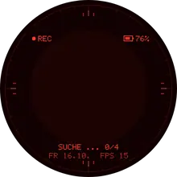<br><b>KI-Vision</b><br><sub>Objekterkennung: Bounding-Boxen erkennen deine Werte mit Konfidenz („STRESS 28 · 97 %“)</sub></td>
<td align="center" valign="top" width="25%">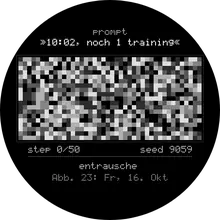<br><b>Latent</b><br><sub>Bei jedem Handgelenk-Heben entsteht die Uhrzeit wie bei einem Bildgenerator aus Rauschen – jedes Mal mit neuem Seed</sub></td>
<td align="center" valign="top" width="25%"><br><b>KI-Coach</b><br><sub>Chat mit deinem Coach: bei jedem Blick eine neue Nachricht aus Body Battery, Schlaf, Erholung, Wochenziel</sub></td>
</tr>
<tr>
<td align="center" valign="top" width="25%">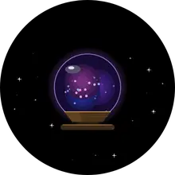<br><b>KI-Orakel</b><br><sub>Orakel-Kugel, die bei jedem Heben eine Frage zu deinem Tag beantwortet</sub></td>
<td align="center" valign="top" width="25%">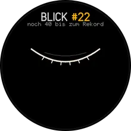<br><b>Blick-Zähler</b><br><sub>Zählt, wie oft du heute auf die Uhr schaust: Abzeichen, Vergleich mit gestern</sub></td>
<td align="center" valign="top" width="25%">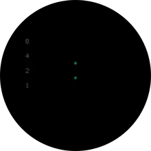<br><b>Geheimcode</b><br><sub>Uhrzeit binär, als Morsecode oder römisch – nach ein paar Sekunden entschlüsselt sie sich</sub></td>
<td align="center" valign="top" width="25%">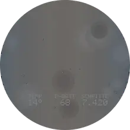<br><b>Nebel</b><br><sub>Beschlagenes Display: ein Finger wischt die Uhrzeit frei, dann zieht der Nebel wieder zu</sub></td>
</tr>
</table>

### Daten-Kunst & wild

<table>
<tr>
<td align="center" valign="top" width="25%">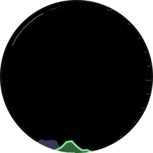<br><b>Energy Core</b><br><sub>Body Battery als Flüssigkeit; Stress macht die Wellen wild</sub></td>
<td align="center" valign="top" width="25%">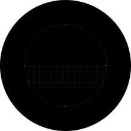<br><b>Pulse</b><br><sub>2 h Herzfrequenz als Radial-Spektrum, EKG im echten Takt</sub></td>
<td align="center" valign="top" width="25%">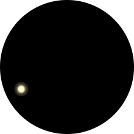<br><b>Daylight</b><br><sub>Sonnenstand, Goldene Stunde, Rest-Tageslicht, Mondphase</sub></td>
<td align="center" valign="top" width="25%">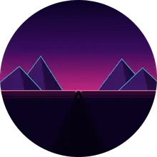<br><b>Synthwave</b><br><sub>Retro-Sonne nach echtem Sonnenstand, Gitter rast im Pulstakt</sub></td>
</tr>
<tr>
<td align="center" valign="top" width="25%">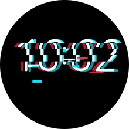<br><b>Glitch</b><br><sub>Die Uhr glitcht im Takt deines Stresslevels</sub></td>
<td align="center" valign="top" width="25%">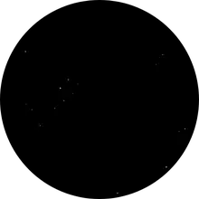<br><b>Orbit</b><br><sub>Sonnensystem: Planeten für Stunde und Minute, Komet für Sekunden, echter Mond</sub></td>
<td align="center" valign="top" width="25%">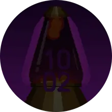<br><b>Lavalampe</b><br><sub>Wachsblasen steigen und verschmelzen – je wärmer es draußen ist, desto lebhafter</sub></td>
<td align="center" valign="top" width="25%">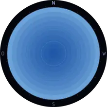<br><b>Sternenhimmel</b><br><sub>Der echte Himmel über deinem Standort: 151 Sterne, Sternbilder, Mond in echter Phase; Polarlicht-Variante</sub></td>
</tr>
</table>

### Ein Tag im Zeitraffer

Viele Designs leben mit dem echten Tag: Sonnenstand, Dämmerung, Nacht und Mond berechnet die Uhr selbst aus Datum und Standort. So sehen sie von 0 bis 24 Uhr aus (eine Viertelstunde pro Bild):

<table>
<tr>
<td align="center" valign="top" width="25%">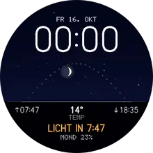<br><b>Daylight</b><br><sub>Sonnenbogen, Dämmerung, Goldene Stunde, nachts der Mond</sub></td>
<td align="center" valign="top" width="25%">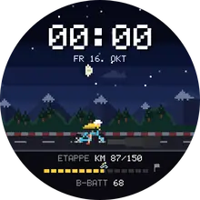<br><b>Pixel Rider</b><br><sub>Himmel, Sonne und Sterne folgen dem echten Sonnenstand</sub></td>
<td align="center" valign="top" width="25%">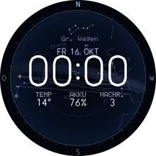<br><b>Sternenhimmel</b><br><sub>Der Himmel dreht sich, tagsüber blau, nachts Sternbilder</sub></td>
<td align="center" valign="top" width="25%">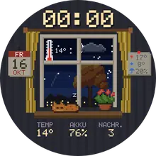<br><b>Wetterfenster</b><br><sub>Tag und Nacht vor dem Fenster, die Katze schläft nachts</sub></td>
</tr>
<tr>
<td align="center" valign="top" width="25%">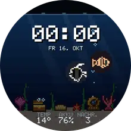<br><b>Aquarium</b><br><sub>Nachts wird das Becken dunkel und die Fische leuchten</sub></td>
<td align="center" valign="top" width="25%">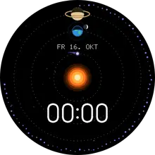<br><b>Orbit</b><br><sub>Planeten für Stunde und Minute ziehen ihre Bahnen</sub></td>
<td align="center" valign="top" width="25%">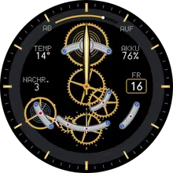<br><b>Skelett</b><br><sub>Zeiger und Räderwerk im Zeitraffer</sub></td>
<td align="center" valign="top" width="25%">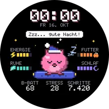<br><b>Pixel Buddy</b><br><sub>Schläft nachts mit Mütze, wacht morgens auf</sub></td>
</tr>
</table>

<details>
<summary><b>Alle Varianten ansehen</b> (jedes Design hat drei)</summary>

**Mono**: Outline · Bold · Stack

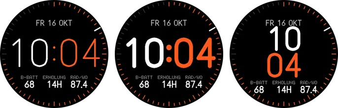

**Chronograph**: Noir · Panda · Racing

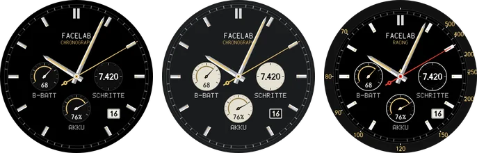

**Bahnhofsuhr**: Klassisch · Nacht · Kelle

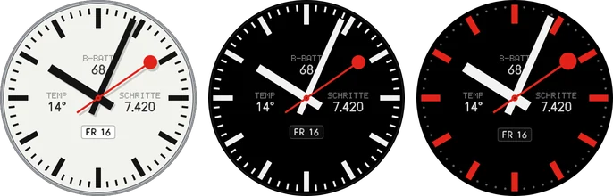

**Wortuhr**: Klassisch · Akzent · Neon

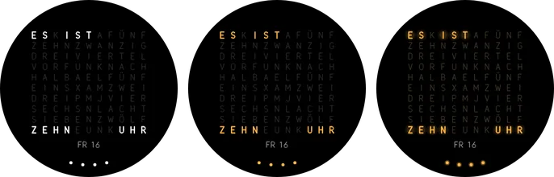

**Split-Flap**: Bahnhof · Café · Akzent


**Nixie**: Klassisch · Eisblau · Dekatron


**Skelett**: Gold · Stahl · Tourbillon


**Bauhaus**: Bauhaus · Mondrian · Memphis


**Alpe 21**: Serpentinen · Nacht · Profil


**Tour de Woche**: Maillot · Klassik · Nacht


**Velodrom**: Holz · Nacht · Neon


**Power HUD**: Watopia · Carbon · Neon


**Drivetrain**: Carbon · Chrom · Neon


**Wochenbilanz**: Heatmap · Balken · Pixel


**Pixel Rider**: Tag & Nacht · Gameboy · Neon


**Pixel City**: Neon-Nacht · Retro · Winter


**Pixel Buddy**: Klassik · Gameboy · Pastell


**Dungeon**: Verlies · Wald · Lava


**Muncher**: Arcade · Gameboy · Neon


**Daily Quest**: Pixel · Clean · Neon


**Terminal**: Phosphor · Amber · Matrix


**Blockfall**: Klassik · Gameboy · Neon


**Aquarium**: Riff · Teich · Tiefsee


**Wetterfenster**: Fenster · Postkarte · Diorama


**Neuronetz**: Synapse · Schaltplan · Bio


**KI-Vision**: Terminator · Clean · Thermal


**Latent**: Diffusion · Pixel · Aquarell


**KI-Coach**: Messenger · Terminal · Glas


**KI-Orakel**: Kristall · Nebula · 8-Bit


**Blick-Zähler**: Auge · Pixel · Minimal


**Geheimcode**: Binär · Morse · Römisch


**Nebel**: Beschlagen · Frost · Rauch


**Energy Core**: Plasma · Ozean · Lava


**Pulse**: Monitor · Zonen · Akzent


**Daylight**: Himmel · Linie · 24h


**Synthwave**: Outrun · Sunset · Vapor


**Glitch**: RGB · Vaporwave · Mono


**Orbit**: Kosmos · Blueprint · Eclipse


**Lavalampe**: Retro · Ozean · Plasma


**Sternenhimmel**: Planetarium · Sternkarte · Polarlicht


</details>

**Trainingstage** erkennt FaceLab selbst: Ein Tag zählt, wenn er mindestens 30 Aktivminuten hat oder
die Wochen-Rad-/Lauf-Distanz an diesem Tag um mehr als 1 km gewachsen ist.

**Interaktion:** Garmin gibt Watchfaces keine normalen Touch-Eingaben (Antippen geht nur im
Watchface-Editor). Die interaktiven Designs reagieren deshalb auf das **Handgelenk-Heben**: Jeder Blick
zählt, erzeugt eine neue Antwort, einen neuen Seed oder eine neue Wisch-Geste. Auf Geräten, die
langes Drücken an das Watchface weiterreichen, liefern KI-Coach und KI-Orakel damit zusätzlich eine
neue Nachricht und Geheimcode entschlüsselt sich erneut (im Simulator nicht prüfbar).

Alle Designs haben drei Varianten, eine Intro-Animation beim Handgelenk-Heben, teils fortlaufende
Animationen (solange die Uhr wach ist, ca. 10 s) und einen eigenen, stromsparenden Always-On-Modus
für das AMOLED-Display (Burn-in-Schutz inklusive).

## Anpassen an der Uhr

* **Watchface-Editor der Uhr** (Watchface lange drücken → Anpassen): Variante, Akzentfarbe,
  Datenfarbe und drei Datenfelder (Body Battery, Erholungszeit, Rad-km der Woche, VO2max Rad,
  Schlafscore, Rennprognosen, …).
* **Einstellungen des Watchfaces** (Menü): FTP, Gewicht, Kletterziel, Quest-Stufe,
  Rad-Wochenziel, Animation an/aus.
* **Face-Code:** Jede Konfiguration lässt sich als Code (`FL1.ALPE.1.FF6A2B…`) kopieren und im Studio
  wieder laden.

## Wie es funktioniert

```
web/            Studio (Website) + Web-Version jedes Designs (Canvas)
  js/engine/    Zeichen-Engine, die die Garmin-Grafik-API nachbildet
  js/faces/     ein Modul pro Design
  prg/          fertig kompilierte Watchfaces (Basis für den Generator)
watch/          Connect IQ Projekt (Monkey C)
  source/       Engine: Daten, Konfiguration, Animation, Always-On, Schriften
  source/faces/ ein Design pro Datei (Zeile für Zeile identisch zur Web-Version)
tools/          Build, Schrift-Generator, Bundler, Simulator-Helfer, README-Medien
docs/media/     Animationen und Bilder für diese README (`node tools/media.mjs`)
site/           gebündeltes Studio (eine HTML-Datei)
```

* **Ein Code, zwei Welten:** Jedes Design existiert als JavaScript (Vorschau) und als Monkey C (Uhr) mit
  identischer Logik. Die Vorschau zeichnet über eine Nachbildung der Garmin-`Dc`-API, und alle Texte
  laufen über eigene, prozedurale Schriften (Vektor, 5×7-Pixel, 7-Segment) – dadurch sieht die
  Vorschau aus wie die Uhr.
* **Ein Design pro Watchface:** Watchfaces haben auf der FR970 nur 128 KB Speicher. Jedes Design wird
  deshalb als eigenes schlankes Watchface gebaut (Engine + ein Design: 46–84 KB im Simulator gemessen).
* **Generator im Browser:** Jede `.prg` enthält Platzhalter für Face-Code, Namen und App-ID. Das Studio
  setzt deine Konfiguration ein und signiert die Datei neu (RSA, SHA-1 + SHA-256, wie der Garmin-Compiler).
  Den Schlüssel erzeugt `tools/build.py` beim ersten Build lokal in `tools/keys/` (nicht im Repo);
  `tools/bundle.mjs` bettet ihn in `site/FaceLab.html` ein. Die gebündelte Studio-Datei enthält damit
  deinen Signier-Schlüssel: Behalte sie für dich und nutze für eine Veröffentlichung im Connect IQ
  Store einen separaten Schlüssel.
* **Daten:** Body Battery, Stress, Schlafscore, Erholungszeit, VO2max (Lauf/Rad), Wochen-km Rad/Lauf,
  Trainingsstatus, Rennprognosen, Atemfrequenz, SpO2 kommen über die Connect-IQ-„Complications“;
  Herzfrequenz-/Body-Battery-/Stress-Verläufe über `SensorHistory`; Sonne und Mond werden auf der Uhr
  selbst berechnet (NOAA-Formeln).

## Selbst bauen

Voraussetzungen: Java 17+, Python 3, Node 18+, [Connect IQ SDK](https://developer.garmin.com/connect-iq/sdk/) (Linux/macOS/Windows).

```bash
npm install                          # esbuild für das Studio
node tools/fontgen.mjs               # Schriftdaten erzeugen (Web + Uhr)
mkdir -p ~/.Garmin/ConnectIQ/Devices && cp -r tools/device/fr970 ~/.Garmin/ConnectIQ/Devices/
CIQ_SDK=/pfad/zum/sdk CIQ_RELEASE=1 python3 tools/build.py      # alle Designs → dist/*.prg
cp dist/*.prg web/prg/ && node tools/bundle.mjs                  # Studio → site/FaceLab.html
```

`tools/device/fr970/compiler.json` ist eine eigene, minimale Gerätebeschreibung, mit der der Compiler
byte-identische Ergebnisse wie mit Garmins offiziellen Gerätedateien liefert. Wer den SDK-Manager nutzt,
kann stattdessen das offizielle FR970-Gerät installieren.

Die GitHub Action `.github/workflows/build.yml` baut bei jedem Push und Pull Request alle Watchfaces und das
Studio. Bei Pushes auf `main` stellt sie beides 14 Tage lang als Artefakt bereit. Manuell gestartet („Run workflow“) nimmt sie optional einen Face-Code
entgegen und liefert genau dieses Watchface.

Neue Designs: siehe [`docs/FACE_GUIDE.md`](docs/FACE_GUIDE.md).
