# FaceLab – Watchface-Studio für die Forerunner 970

FaceLab ist ein Studio für eigene Garmin-Watchfaces: eine Website mit 78 fertigen Designs, die du live
ansehen, anpassen und mit einem Klick per USB auf die Uhr übertragen kannst – direkt im Browser,
ohne SDK, ohne Konto, ohne Connect IQ Store, ohne Zusatzprogramm.

<p align="center"></p>

## Schnellstart

1. **Studio öffnen:** `site/FaceLab.html` im Browser öffnen (Doppelklick genügt, funktioniert offline).
   Die Datei entsteht mit `node tools/bundle.mjs` (siehe unten) oder als Artefakt der GitHub Action.
2. Design wählen, Variante/Farben/Datenfelder einstellen.
3. Uhr per USB anschließen und auf **„Direkt auf die Uhr übertragen (USB)“** klicken (Chrome, Edge oder
   Brave; WebUSB, kein Zusatzprogramm nötig), Forerunner im Dialog wählen, Uhr trennen.
   Ohne Chromium-Browser: **„Watchface erzeugen (.zip)“**, ZIP entpacken und die `.prg` mit
   [OpenMTP](https://openmtp.ganeshrvel.com/) nach `GARMIN/APPS` kopieren.
4. Auf der Uhr: Watchface lange drücken → Watchface wählen → dein neues Design.

Der Name bestimmt den Platz auf der Uhr: Mit gleichem Namen neu erzeugen und die Datei ersetzen
aktualisiert das Watchface; ein neuer Name legt ein zusätzliches an. So kannst du mehrere Varianten
gleichzeitig auf der Uhr haben.

## Die Designs

Alle 78 Designs auf einen Blick (gerendert mit derselben Engine wie die Vorschau im Studio):

<p align="center"></p>

Die Animationen zeigen, was beim Handgelenk-Heben passiert: Intro und die ersten Sekunden der laufenden Animation.

### Klassisch

<table>
<tr>
<td align="center" valign="top" width="25%"><br><b>Mono</b><br><sub>Riesige Monoline-Ziffern, die sich beim Handgelenk-Heben selbst schreiben</sub></td>
<td align="center" valign="top" width="25%"><br><b>Chronograph</b><br><sub>Analoger Chronograph mit Hilfszifferblättern und gleitendem Sekundenzeiger</sub></td>
<td align="center" valign="top" width="25%"><br><b>Bahnhofsuhr</b><br><sub>Roter Kellen-Sekundenzeiger: 58,5 s Umlauf, Halt bei 12, Minutensprung</sub></td>
<td align="center" valign="top" width="25%"><br><b>Wortuhr</b><br><sub>„ES IST VIERTEL NACH ZEHN“ – deutsche Wortuhr</sub></td>
</tr>
<tr>
<td align="center" valign="top" width="25%"><br><b>Split-Flap</b><br><sub>Bahnhofs-Klapptafel, die sich durchblättert</sub></td>
<td align="center" valign="top" width="25%"><br><b>Nixie</b><br><sub>Glühende Nixie-Röhren, die beim Heben alle Ziffern durchlaufen; Dekatron-Variante mit Sekunden-Glimmpunkt</sub></td>
<td align="center" valign="top" width="25%"><br><b>Skelett</b><br><sub>Offenes Uhrwerk mit schwingender Unruh, Räderwerk und Tourbillon; Gangreserve = Akku</sub></td>
<td align="center" valign="top" width="25%"><br><b>Bauhaus</b><br><sub>Kreis, Quadrat, Dreieck: Stunde und Minute als Formen, jede Minute neu komponiert (auch Mondrian, Memphis)</sub></td>
</tr>
<tr>
<td align="center" valign="top" width="25%">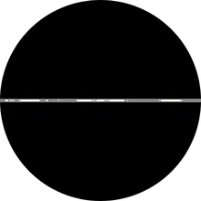<br><b>Pixel-Chronograph</b><br><sub>Klassischer Chronograph ganz aus Pixeln: Tachymeter, Hilfszifferblätter, Treppchen-Zeiger; beim Heben läuft die Stoppuhr eine Runde</sub></td>
</tr>
</table>

### Im Pebble-Stil

Eine Verbeugung vor der Pebble: schwarz-weiß wie E-Paper oder in der 64-Farben-Palette der Pebble Time,
Bitmap-Schrift, durchgestrichenes Bluetooth-Symbol ohne Handy – und so still wie das Original, nur beim
Heben gibt es die typische Animation.

<table>
<tr>
<td align="center" valign="top" width="25%">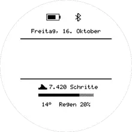<br><b>Kiesel</b><br><sub>TicToc-Layout: Datum, Haarlinien, große runde Ziffern, Schritte mit Raster-Balken, Akku und Bluetooth</sub></td>
<td align="center" valign="top" width="25%">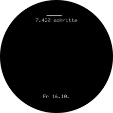<br><b>Kiesel Text</b><br><sub>Die Text Watch auf Deutsch: „zehn / zweiund / vierzig“, oben ein Datenfeld nach Wahl, die Zeilen gleiten von rechts herein</sub></td>
<td align="center" valign="top" width="25%">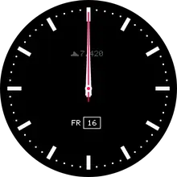<br><b>Kiesel Analog</b><br><sub>Simple Analog: kräftige Striche, roter Sekundenzeiger, Datum im Kästchen, Zeiger drehen ein</sub></td>
<td align="center" valign="top" width="25%">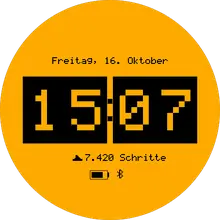<br><b>Kiesel Rolle</b><br><sub>Ziffernwalzen, die beim Heben wie ein Spielautomat rotieren und nacheinander einrasten</sub></td>
</tr>
</table>

### AMOLED

Gemacht für das AMOLED-Display: Schwarz ist hier wirklich aus, Farben leuchten.

**Fotorealistisch:** Diese Designs werden nicht aus Linien und Flächen gezeichnet, sondern aus
vorgerenderten Bildern zusammengesetzt (gebürstetes Metall, polierte Kanten, Leuchtmasse, Nebel). Die Uhr
dreht sie mit bilinearer Filterung, färbt sie ein und lässt Licht per GPU additiv leuchten.

<table>
<tr>
<td align="center" valign="top" width="25%">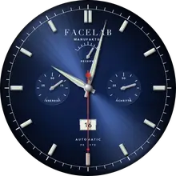<br><b>Manufaktur</b><br><sub>Automatikuhr mit Sonnenschliff, facettierten Indizes und Dauphine-Zeigern; Gangreserve = Akku, Hilfszifferblätter für Body Battery und Schritte, nachts leuchtet die Leuchtmasse</sub></td>
<td align="center" valign="top" width="25%">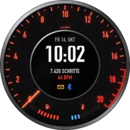<br><b>Cockpit</b><br><sub>Hinterleuchtetes Kombiinstrument: Drehzahl = Puls, Tank = Body Battery, Temperatur = Stress, Kontrollleuchten, Nadel-Sweep beim Heben</sub></td>
<td align="center" valign="top" width="25%">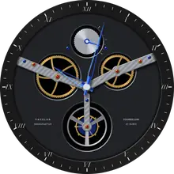<br><b>Tourbillon</b><br><sub>Skelettiertes Werk mit Genfer Streifen, Perlage, Rubinen und gebläuten Schrauben; Räder, Käfig und Unruh laufen live</sub></td>
<td align="center" valign="top" width="25%">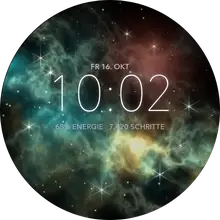<br><b>Tiefer Raum</b><br><sub>Teleskopblick in einen Nebel: Beugungssterne funkeln, Sternschnuppe beim Heben, der Nebel leuchtet mit der Body Battery</sub></td>
</tr>
<tr>
<td align="center" valign="top" width="25%">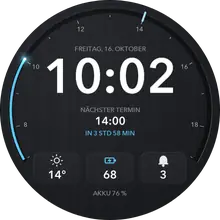<br><b>Arbeitstag</b><br><sub>Fürs Büro: große Uhrzeit, der Arbeitstag als Leiste mit dem nächsten Kalendertermin („in 38 min“), Wetter, Body Battery und Nachrichten</sub></td>
</tr>
</table>

Dazu Licht auf Schwarz, das Akku spart:

<table>
<tr>
<td align="center" valign="top" width="25%">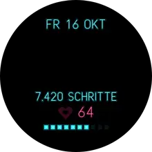<br><b>Neon</b><br><sub>Glühende Neonröhren, die beim Heben flackernd zünden; ein Neon-Herz schlägt im echten Puls</sub></td>
<td align="center" valign="top" width="25%">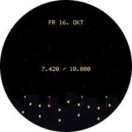<br><b>Feuerwerk</b><br><sub>Raketen steigen über der Skyline auf, ihre Funken werden zur Uhrzeit; beim Schrittziel das Finale</sub></td>
<td align="center" valign="top" width="25%">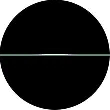<br><b>Plasmakugel</b><br><sub>Die Zeit im glühenden Kern, Blitze zur Glaswand: mehr Stress, mehr Blitze, höherer Puls, schnellere Blitze</sub></td>
<td align="center" valign="top" width="25%">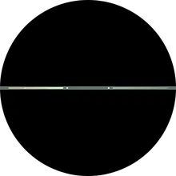<br><b>Schwarzes Loch</b><br><sub>Gargantua: Akkretionsscheibe, gekrümmter Lichtbogen, Kepler-Bahnen und Doppler-Leuchten</sub></td>
</tr>
</table>

### Rad & Training

<table>
<tr>
<td align="center" valign="top" width="25%"><br><b>Alpe 21</b><br><sub>21 Kehren der Alpe d'Huez (oder Ventoux, Stelvio, Everest) – Antrieb wählbar: Höhenmeter, Rad-km-Wochenziel oder Trainingstage</sub></td>
<td align="center" valign="top" width="25%"><br><b>Tour de Woche</b><br><sub>Die Woche als Rundfahrt: 7 Etappen, Gelbes (Rad-km), Grünes (Trainingstage) und Bergtrikot (Höhenmeter)</sub></td>
<td align="center" valign="top" width="25%"><br><b>Velodrom</b><br><sub>Wochen-km als Runden auf der 250-m-Bahn, Rundentafel und Zielglocke</sub></td>
<td align="center" valign="top" width="25%"><br><b>Power HUD</b><br><sub>Zwift-inspiriert: FTP, W/kg, Kategorie, Zonen in Watt, Workout des Tages</sub></td>
</tr>
<tr>
<td align="center" valign="top" width="25%"><br><b>Drivetrain</b><br><sub>Kettenblatt und Kassette als Uhr – jede Stunde ein Ritzel weiter</sub></td>
<td align="center" valign="top" width="25%"><br><b>Wochenbilanz</b><br><sub>Heatmap der Woche, Trainingstage als Ring</sub></td>
</tr>
</table>

### Pixel-Art

<table>
<tr>
<td align="center" valign="top" width="25%"><br><b>Pixel Rider</b><br><sub>8-Bit-Sidescroller mit Parallax, echter Tag/Nacht-Himmel, Etappenziel mit Zielbanner</sub></td>
<td align="center" valign="top" width="25%"><br><b>Pixel City</b><br><sub>Skyline, in der jede erklommene Etage ein Fenster erleuchtet; S-Bahn, Regen, Schnee</sub></td>
<td align="center" valign="top" width="25%"><br><b>Pixel Buddy</b><br><sub>Tamagotchi, das auf Body Battery, Stress, Schritte und Schlaf reagiert</sub></td>
<td align="center" valign="top" width="25%"><br><b>Dungeon</b><br><sub>Täglich ein neues Monster – deine Schritte sind die Angriffe, Gold und Sieg-Serie</sub></td>
</tr>
<tr>
<td align="center" valign="top" width="25%"><br><b>Muncher</b><br><sub>Arcade-Labyrinth: frisst deine Schritt-Punkte, Stress bringt Geister</sub></td>
<td align="center" valign="top" width="25%"><br><b>Daily Quest</b><br><sub>Drei tägliche Quests, XP, Level und Streak</sub></td>
<td align="center" valign="top" width="25%"><br><b>Terminal</b><br><sub>Grüner Phosphor, Shell-Session mit deinen Körperdaten</sub></td>
<td align="center" valign="top" width="25%"><br><b>Blockfall</b><br><sub>Fallende Blöcke stapeln sich zur Uhrzeit, Reihen werden abgeräumt, Rekord wird gespeichert</sub></td>
</tr>
<tr>
<td align="center" valign="top" width="25%"><br><b>Aquarium</b><br><sub>Riff, Koi-Teich oder Tiefsee; nachts dunkel, beim Heben kommen die Fische an die Scheibe</sub></td>
<td align="center" valign="top" width="25%"><br><b>Wetterfenster</b><br><sub>Pixel-Fenster mit dem echten Wetter: Regen an der Scheibe, Schnee auf dem Sims, Katze, Postkarte, Diorama</sub></td>
</tr>
</table>

### KI, interaktiv & versteckte Uhrzeit

<table>
<tr>
<td align="center" valign="top" width="25%"><br><b>Neuronetz</b><br><sub>Körperdaten als Eingänge eines neuronalen Netzes, Signale pulsieren bis zur Uhrzeit</sub></td>
<td align="center" valign="top" width="25%"><br><b>KI-Vision</b><br><sub>Objekterkennung: Bounding-Boxen erkennen deine Werte mit Konfidenz („STRESS 28 · 97 %“)</sub></td>
<td align="center" valign="top" width="25%"><br><b>Latent</b><br><sub>Bei jedem Handgelenk-Heben entsteht die Uhrzeit wie bei einem Bildgenerator aus Rauschen – jedes Mal mit neuem Seed</sub></td>
<td align="center" valign="top" width="25%"><br><b>KI-Coach</b><br><sub>Chat mit deinem Coach: bei jedem Blick eine neue Nachricht aus Body Battery, Schlaf, Erholung, Wochenziel</sub></td>
</tr>
<tr>
<td align="center" valign="top" width="25%"><br><b>KI-Orakel</b><br><sub>Orakel-Kugel, die bei jedem Heben eine Frage zu deinem Tag beantwortet</sub></td>
<td align="center" valign="top" width="25%"><br><b>Blick-Zähler</b><br><sub>Zählt, wie oft du heute auf die Uhr schaust: Abzeichen, Vergleich mit gestern</sub></td>
<td align="center" valign="top" width="25%"><br><b>Geheimcode</b><br><sub>Uhrzeit binär, als Morsecode oder römisch – nach ein paar Sekunden entschlüsselt sie sich</sub></td>
<td align="center" valign="top" width="25%"><br><b>Nebel</b><br><sub>Beschlagenes Display: ein Finger wischt die Uhrzeit frei, dann zieht der Nebel wieder zu</sub></td>
</tr>
</table>

### Gesundheit verstehen

Diese Designs ziehen Schlüsse aus deinen Gesundheitsdaten und sagen in Klartext, was sie bedeuten. Alle
nutzen dieselbe nachvollziehbare Rechnung: Die Tagesform ist ein gewichteter Mittelwert aus Body Battery
(40 %), Schlafscore (25 %), Ruhe = 100 − Stress der letzten 2 Stunden (20 %) und Erholung (15 %); jeder
Faktor zeigt, wie viele Punkte er bringt oder kostet. Daraus folgt die Verfassung (topfit, solide, müde,
erschöpft, gestresst), und nach ihr richten sich Farben, Wetter und Szenen.

<table>
<tr>
<td align="center" valign="top" width="25%">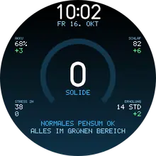<br><b>Tagesform</b><br><sub>Score aus Body Battery, Schlaf, Stress und Erholung – jeder Faktor mit Plus/Minus, dazu Rat und Hauptgrund</sub></td>
<td align="center" valign="top" width="25%">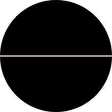<br><b>Innenwetter</b><br><sub>Deine Verfassung als Wetter: Sonne, Nebel, Regen, Gewitter, Regenbogen – und daneben das Wetter draußen</sub></td>
<td align="center" valign="top" width="25%">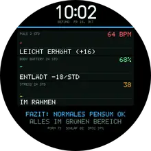<br><b>Befund</b><br><sub>Puls, Body Battery und Stress als Kurven, zu jeder ein Befund in Klartext, unten das Fazit</sub></td>
<td align="center" valign="top" width="25%">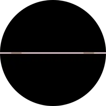<br><b>Was geht heute?</b><br><sub>Trainingsempfehlung als Szene: Ruhetag, Entspannen, Spaziergang, Rad locker bis Intervalle, bei Regen die Rolle</sub></td>
</tr>
<tr>
<td align="center" valign="top" width="25%">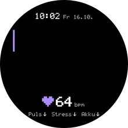<br><b>Live-Coach</b><br><sub>Was passiert gerade in deinem Körper? Zustand, Grund und Tipp aus Puls, Bewegung, Stress- und Body-Battery-Trend; der Puls tickt live</sub></td>
</tr>
</table>

Der **Live-Coach** schaut nicht auf den Tag, sondern auf **jetzt**: Er kombiniert Puls und Ruhepuls,
Schritte der letzten 10 Minuten, Minuten ohne Bewegung und die Trends von Puls, Stress und Body Battery
zu einem von zehn Zuständen – Volle Belastung, In Bewegung, Nachbrenner, Zeit runterzufahren,
Anspannung im Sitzen, Läuft auf Reserve, Spannung lässt nach, Lange gesessen, Lädt gerade auf, Ruhig
und erholt (in dieser Reihenfolge geprüft). Dazu sagt er locker, woran er es sieht, und gibt einen Tipp,
bei jedem Blick in anderen Worten. Während du hinschaust, liest er den Puls jede Sekunde neu; im Stil
*Aura* atmest du bei Anspannung mit einem Kreis mit (4 s ein, 6 s aus). Das ist eine Einschätzung aus
den Sensordaten, keine Diagnose.

### Avatar

<table>
<tr>
<td align="center" valign="top" width="25%">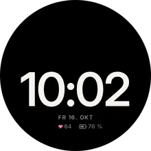<br><b>Mo</b><br><sub>Ein flauschiges Robbenbaby wohnt auf deiner Uhrzeit und zeigt mit seiner Laune, wie es deinem Körper gerade geht</sub></td>
</tr>
</table>

**Mo** wohnt auf deiner Uhrzeit. Bei jedem Blick spielt er eine andere Szene: Er sitzt auf den Ziffern
und lässt die Beine baumeln, lugt hinter der Minute hervor, hängt am Doppelpunkt oder stampft die neue
Minute fest. Nachts schläft er quer über der Zeit und rollt beim Heben gähnend zur Seite, nach dem
Sport jubelt er mit Stirnband. Seine Laune kommt vom Live-Coach: Bei Anspannung sträubt sich sein Fell
und er atmet mit dir (4 s ein, 6 s aus), bei leerem Akku ist er müde, beim Aufladen kuschelig, nach
langem Sitzen hüpft er auffordernd. In der Sprechblase sagt er dir, was los ist. Sein Fell ist vorab
gerendert (`tools/render/mo.py`), Augen, Blinzeln, Mund und Effekte zeichnet die Uhr live.

### Pixel-Geschichten

Jedes dieser Designs erzählt eine kleine Geschichte, die deine Daten und die echte Uhrzeit weiterschreiben.
Bei jedem Handgelenk-Heben spielt eine kurze Episode.

**Sie leben mit dem Jahr und dem echten Wetter:** Bei Schnee oder Frost liegt Schnee auf Dächern, Feldern
und Felsen, Regen und Schneeflocken fallen, wenn es draußen wirklich regnet oder schneit, im Herbst färben
sich die Hügel. Im Advent hängen Lichterketten und ein Christbaum steht im Bild, an Silvester gibt es
Feuerwerk, dazu Ostereier, Kürbisse zu Halloween, ein Herz am Valentinstag und Luftballons an deinem
Geburtstag (im Studio einstellen) – mit Gruß statt Datum.

<p align="center">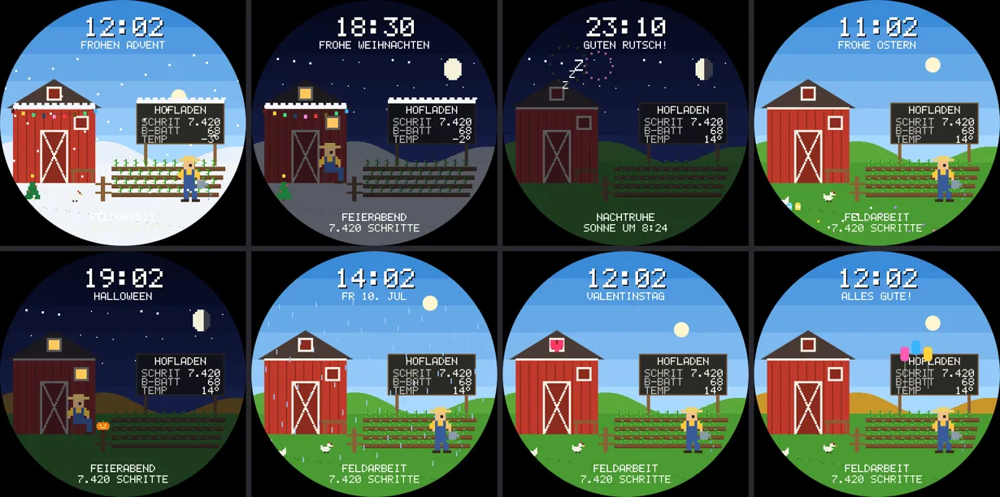</p>

<table>
<tr>
<td align="center" valign="top" width="25%">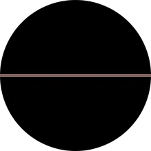<br><b>Mondflug</b><br><sub>Jede Woche eine Mondmission: Countdown, Zündung, das Wochenziel trägt die Rakete bis zur Landung</sub></td>
<td align="center" valign="top" width="25%">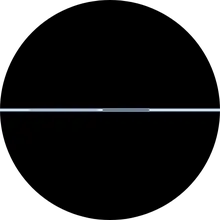<br><b>Büro</b><br><sub>Ein Arbeitstag nach echter Uhr: Kaffee, Videocall, Feierabend, nachts die Putzkolonne</sub></td>
<td align="center" valign="top" width="25%">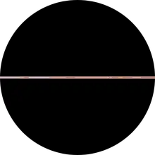<br><b>Bergsteiger</b><br><sub>Expedition zum Gipfel: Etagen tragen dich von Lager zu Lager, nachts im Zelt, am Ziel die Fahne</sub></td>
<td align="center" valign="top" width="25%">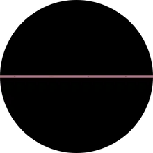<br><b>Rennfahrer</b><br><sub>Ein Rennen über die Woche: Aktivminuten sind Runden, Boxenstopp bei leerer Body Battery, Zielflagge</sub></td>
</tr>
<tr>
<td align="center" valign="top" width="25%">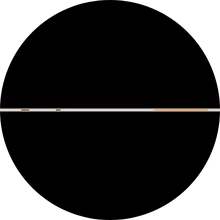<br><b>Lagerfeuer</b><br><sub>Ein Tag im Zeltlager: Schlafen, Morgenkaffee, Wanderung, abends Marshmallows – das Feuer brennt so hoch wie die Body Battery</sub></td>
<td align="center" valign="top" width="25%">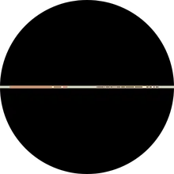<br><b>Pixel-Hof</b><br><sub>Hahn kräht, das Feld wächst mit den Schritten bis zur Ernte, abends die Bank vor der Scheune</sub></td>
<td align="center" valign="top" width="25%">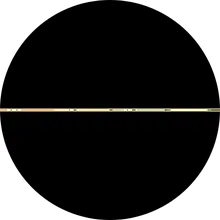<br><b>Postbote</b><br><sub>Der Postbote läuft Haus für Haus seine Runde, Nachrichten sind Briefe in der Tasche</sub></td>
<td align="center" valign="top" width="25%">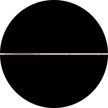<br><b>Bäckerei</b><br><sub>Nachts geht der Teig, um drei der Ofen, tagsüber kommen Kunden – abends ist alles verkauft</sub></td>
</tr>
<tr>
<td align="center" valign="top" width="25%">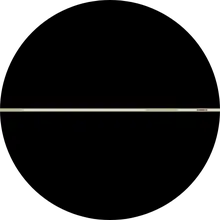<br><b>Pixel-Zug</b><br><sub>Jeder Trainingstag hängt einen beladenen Waggon an, das Wochenziel ist der Bahnhof</sub></td>
<td align="center" valign="top" width="25%">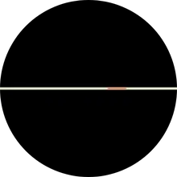<br><b>Leuchtturm</b><br><sub>Der Wärter angelt, zündet in der Dämmerung das Licht, nachts kreist der Kegel über die See</sub></td>
<td align="center" valign="top" width="25%">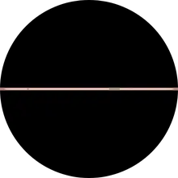<br><b>Schatzkarte</b><br><sub>Das Schiff segelt mit dem Wochenziel Insel um Insel zum roten X, am Ziel öffnet sich die Truhe</sub></td>
</tr>
</table>

### Wächst mit dir

Diese Designs haben ein Gedächtnis: Sie bewerten jeden Tag (Schlafscore 30 %, Schritte zum Ziel 40 %,
Ruhe = 100 − Stress 15 %, Body Battery 15 %) und merken sich das Ergebnis über Wochen im Speicher der Uhr.
Ab 60 Punkten ist es ein guter Tag; vorher sagen sie dir, wie viele Schritte noch fehlen.

<table>
<tr>
<td align="center" valign="top" width="25%">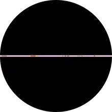<br><b>Pixel-Garten</b><br><sub>Ein Hochbeet vom Samen bis zur Ernte: gute Tage lassen es wachsen, schlechte welken; nach drei guten Tagen zieht ein Igel ein</sub></td>
<td align="center" valign="top" width="25%">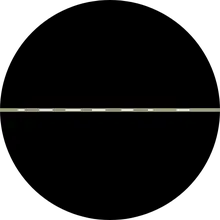<br><b>Finos Reise</b><br><sub>Fortsetzungsgeschichte in 21 Kapiteln: Fuchs Fino reist ans Meer, jeder gute Tag schaltet ein Kapitel frei</sub></td>
<td align="center" valign="top" width="25%">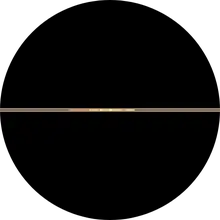<br><b>Tageskunstwerk</b><br><sub>Jeder Tag malt eine Blüte: Schritte = Blätter, Schlaf = Farbe, Stress = Zacken – mit Bildtitel und Wochengalerie</sub></td>
</tr>
</table>

### Alle Sensoren

Diese Designs verwenden so viele Daten der Uhr wie möglich: Puls und Ruhepuls, Body Battery, Stress,
Schlaf, SpO2, Atemfrequenz, VO2max, Schritte, Etagen, Aktivminuten, Kalorien, Distanz, Nachrichten,
Handy-Verbindung, Akku, Höhe, Luftdruck, Wetter, Wind, Sonne und Mond.

<table>
<tr>
<td align="center" valign="top" width="25%">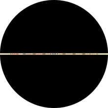<br><b>U-Bahn-Netz</b><br><sub>Sechs Linien = sechs Ziele, die Züge stehen so weit wie du; Durchsagen mit deinen Werten, Glocke bei neuen Nachrichten</sub></td>
<td align="center" valign="top" width="25%">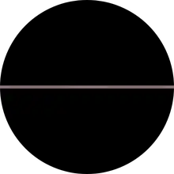<br><b>Kommandobrücke</b><br><sub>Raumschiff-Brücke: Schilde = Body Battery, Reaktor im Pulstakt, Lebenserhaltung atmet mit dir, Stress = Alarm</sub></td>
<td align="center" valign="top" width="25%">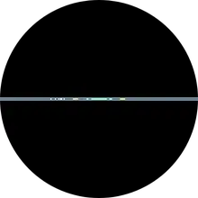<br><b>Körperscan</b><br><sub>Pixel-Anatomie live: Herz schlägt mit deinem Puls, Lungen atmen, Gehirn glüht mit dem Stress</sub></td>
<td align="center" valign="top" width="25%">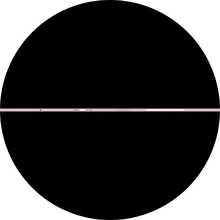<br><b>Wetterstation</b><br><sub>Messgarten: Windrad, Fahne, Thermometer, Regenmesser und Barometer zeigen die echten Werte</sub></td>
</tr>
</table>

### Daten-Kunst & wild

<table>
<tr>
<td align="center" valign="top" width="25%"><br><b>Energy Core</b><br><sub>Body Battery als Flüssigkeit; Stress macht die Wellen wild</sub></td>
<td align="center" valign="top" width="25%"><br><b>Pulse</b><br><sub>2 h Herzfrequenz als Radial-Spektrum, EKG im echten Takt</sub></td>
<td align="center" valign="top" width="25%"><br><b>Daylight</b><br><sub>Sonnenstand, Goldene Stunde, Rest-Tageslicht, Mondphase</sub></td>
<td align="center" valign="top" width="25%"><br><b>Synthwave</b><br><sub>Retro-Sonne nach echtem Sonnenstand, Gitter rast im Pulstakt</sub></td>
</tr>
<tr>
<td align="center" valign="top" width="25%"><br><b>Glitch</b><br><sub>Die Uhr glitcht im Takt deines Stresslevels</sub></td>
<td align="center" valign="top" width="25%"><br><b>Orbit</b><br><sub>Sonnensystem: Planeten für Stunde und Minute, Komet für Sekunden, echter Mond</sub></td>
<td align="center" valign="top" width="25%"><br><b>Lavalampe</b><br><sub>Wachsblasen steigen und verschmelzen – je wärmer es draußen ist, desto lebhafter</sub></td>
<td align="center" valign="top" width="25%"><br><b>Sternenhimmel</b><br><sub>Der echte Himmel über deinem Standort: 151 Sterne, Sternbilder, Mond in echter Phase; Polarlicht-Variante</sub></td>
</tr>
</table>

### Ein Tag im Zeitraffer

Viele Designs leben mit dem echten Tag: Sonnenstand, Dämmerung, Nacht und Mond berechnet die Uhr selbst aus Datum und Standort. So sehen sie von 0 bis 24 Uhr aus (eine Viertelstunde pro Bild):

<table>
<tr>
<td align="center" valign="top" width="25%"><br><b>Daylight</b><br><sub>Sonnenbogen, Dämmerung, Goldene Stunde, nachts der Mond</sub></td>
<td align="center" valign="top" width="25%"><br><b>Pixel Rider</b><br><sub>Himmel, Sonne und Sterne folgen dem echten Sonnenstand</sub></td>
<td align="center" valign="top" width="25%"><br><b>Sternenhimmel</b><br><sub>Der Himmel dreht sich, tagsüber blau, nachts Sternbilder</sub></td>
<td align="center" valign="top" width="25%"><br><b>Wetterfenster</b><br><sub>Tag und Nacht vor dem Fenster, die Katze schläft nachts</sub></td>
</tr>
<tr>
<td align="center" valign="top" width="25%"><br><b>Aquarium</b><br><sub>Nachts wird das Becken dunkel und die Fische leuchten</sub></td>
<td align="center" valign="top" width="25%"><br><b>Orbit</b><br><sub>Planeten für Stunde und Minute ziehen ihre Bahnen</sub></td>
<td align="center" valign="top" width="25%"><br><b>Skelett</b><br><sub>Zeiger und Räderwerk im Zeitraffer</sub></td>
<td align="center" valign="top" width="25%"><br><b>Pixel Buddy</b><br><sub>Schläft nachts mit Mütze, wacht morgens auf</sub></td>
</tr>
<tr>
<td align="center" valign="top" width="25%">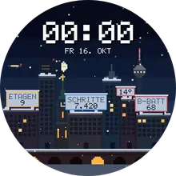<br><b>Pixel City</b><br><sub>Variante Winter: Morgens gehen die Lichter aus, abends wieder an</sub></td>
<td align="center" valign="top" width="25%">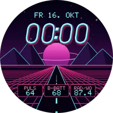<br><b>Synthwave</b><br><sub>Die Retro-Sonne steigt und sinkt mit der echten, nachts ein Ringplanet</sub></td>
</tr>
</table>

Und die Pixel-Geschichten durch ihren Tag:

<table>
<tr>
<td align="center" valign="top" width="25%">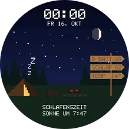<br><b>Lagerfeuer</b><br><sub>Schlafen, Morgenkaffee, Wanderung, Lagerfeuer</sub></td>
<td align="center" valign="top" width="25%">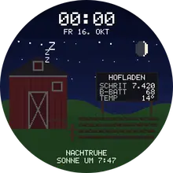<br><b>Pixel-Hof</b><br><sub>Hahn, Feldarbeit, Feierabend, Nachtruhe</sub></td>
<td align="center" valign="top" width="25%">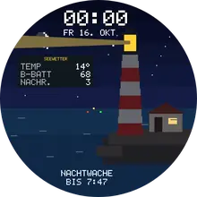<br><b>Leuchtturm</b><br><sub>Das Licht geht in der Dämmerung an und morgens aus</sub></td>
<td align="center" valign="top" width="25%">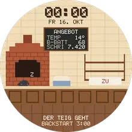<br><b>Bäckerei</b><br><sub>Teig, Backstube, Laden, Feierabend</sub></td>
</tr>
<tr>
<td align="center" valign="top" width="25%">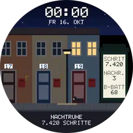<br><b>Postbote</b><br><sub>Die Runde am Tag, abends die Katze unter der Laterne</sub></td>
<td align="center" valign="top" width="25%">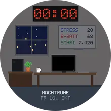<br><b>Büro</b><br><sub>Vom ersten Kaffee bis zur Putzkolonne</sub></td>
</tr>
</table>

<details>
<summary><b>Alle Varianten ansehen</b> (jedes Design hat drei)</summary>

**Mono**: Outline · Bold · Stack


**Chronograph**: Noir · Panda · Racing


**Bahnhofsuhr**: Klassisch · Nacht · Kelle


**Wortuhr**: Klassisch · Akzent · Neon


**Split-Flap**: Bahnhof · Café · Akzent


**Nixie**: Klassisch · Eisblau · Dekatron


**Skelett**: Gold · Stahl · Tourbillon


**Bauhaus**: Bauhaus · Mondrian · Memphis


**Alpe 21**: Serpentinen · Nacht · Profil


**Tour de Woche**: Maillot · Klassik · Nacht


**Velodrom**: Holz · Nacht · Neon


**Power HUD**: Watopia · Carbon · Neon


**Drivetrain**: Carbon · Chrom · Neon


**Wochenbilanz**: Heatmap · Balken · Pixel


**Pixel Rider**: Tag & Nacht · Gameboy · Neon


**Pixel City**: Neon-Nacht · Retro · Winter


**Pixel Buddy**: Klassik · Gameboy · Pastell


**Dungeon**: Verlies · Wald · Lava


**Muncher**: Arcade · Gameboy · Neon


**Daily Quest**: Pixel · Clean · Neon


**Terminal**: Phosphor · Amber · Matrix


**Blockfall**: Klassik · Gameboy · Neon


**Aquarium**: Riff · Teich · Tiefsee


**Wetterfenster**: Fenster · Postkarte · Diorama


**Neuronetz**: Synapse · Schaltplan · Bio


**KI-Vision**: Terminator · Clean · Thermal


**Latent**: Diffusion · Pixel · Aquarell


**KI-Coach**: Messenger · Terminal · Glas


**KI-Orakel**: Kristall · Nebula · 8-Bit


**Blick-Zähler**: Auge · Pixel · Minimal


**Geheimcode**: Binär · Morse · Römisch


**Nebel**: Beschlagen · Frost · Rauch


**Energy Core**: Plasma · Ozean · Lava


**Pulse**: Monitor · Zonen · Akzent


**Daylight**: Himmel · Linie · 24h


**Synthwave**: Outrun · Sunset · Vapor


**Glitch**: RGB · Vaporwave · Mono


**Orbit**: Kosmos · Blueprint · Eclipse


**Lavalampe**: Retro · Ozean · Plasma


**Sternenhimmel**: Planetarium · Sternkarte · Polarlicht


**Pixel-Chronograph**: Panda · Racing · Gameboy

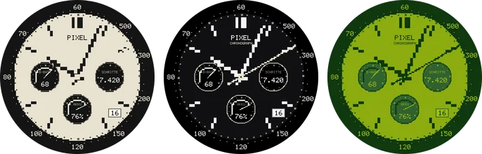

**Mondflug**: Retro · Blaupause · Gameboy

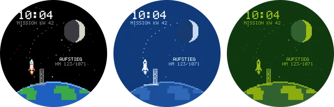

**Büro**: Großraum · Homeoffice · Gameboy

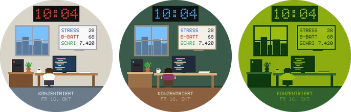

**Bergsteiger**: Fels · Eis · Gameboy


**Rennfahrer**: Grand Prix · Rallye · Gameboy


**Lagerfeuer**: Wald · Strand · Winter


**Pixel-Hof**: Sommer · Herbst · Gameboy


**Postbote**: Stadt · Dorf · Gameboy


**Bäckerei**: Backstube · Café · Gameboy


**Pixel-Zug**: Dampf · Nacht · Gameboy


**Leuchtturm**: Küste · Sturm · Gameboy


**Schatzkarte**: Pergament · Nacht · Gameboy


**U-Bahn-Netz**: Netzplan · Nacht · Gameboy


**Kommandobrücke**: Raumschiff · Bernstein · Gameboy


**Körperscan**: Röntgen · Lehrtafel · Gameboy


**Wetterstation**: Messgarten · Polar · Gameboy


**Kiesel**: Weiß · Schwarz · Farbe


**Kiesel Text**: Weiß · Schwarz · Farbe


**Kiesel Analog**: Weiß · Schwarz · Farbe


**Kiesel Rolle**: Weiß · Schwarz · Farbe


**Neon**: Miami · Motel · Akzent


**Feuerwerk**: Silvester · Gold · Akzent


**Plasmakugel**: Violett · Eis · Akzent


**Schwarzes Loch**: Gargantua · Quasar · Akzent


**Tagesform**: Nacht · Tag · Minimal


**Innenwetter**: Wiese · Pastell · Gameboy


**Befund**: Monitor · Papier · Akzent


**Was geht heute?**: Hell · Nacht · Akzent


**Live-Coach**: Kiesel · Kiesel Weiß · Aura


**Mo**: Nacht · Dämmerung · Kiesel


**Arbeitstag**: Graphit · Navy · Hell


**Manufaktur**: Mitternacht · Fumé · Racing


**Cockpit**: Rot · Eisblau · Amber


**Tourbillon**: Rhodium · Gold · Schwarz


**Tiefer Raum**: Hubble · Webb · Orion


**Pixel-Garten**: Garten · Nacht · Gameboy


**Finos Reise**: Bilderbuch · Nacht · Gameboy


**Tageskunstwerk**: Schwarz · Leinwand · Akzent


</details>

**Trainingstage** erkennt FaceLab selbst: Ein Tag zählt, wenn er mindestens 30 Aktivminuten hat oder
die Wochen-Rad-/Lauf-Distanz an diesem Tag um mehr als 1 km gewachsen ist.

**Interaktion:** Garmin gibt Watchfaces keine normalen Touch-Eingaben (Antippen geht nur im
Watchface-Editor). Die interaktiven Designs reagieren deshalb auf das **Handgelenk-Heben**: Jeder Blick
zählt, erzeugt eine neue Antwort, einen neuen Seed oder eine neue Wisch-Geste. Auf Geräten, die
langes Drücken an das Watchface weiterreichen, liefern KI-Coach und KI-Orakel damit zusätzlich eine
neue Nachricht und Geheimcode entschlüsselt sich erneut (im Simulator nicht prüfbar).

Alle Designs haben drei Varianten, eine Intro-Animation beim Handgelenk-Heben, teils fortlaufende
Animationen (solange die Uhr wach ist, ca. 10 s) und einen eigenen, stromsparenden Always-On-Modus
für das AMOLED-Display (Burn-in-Schutz inklusive).

## Der Assistent

Alle Designs bringen einen kleinen Assistenten mit, der beim Handgelenk-Heben für ein paar Sekunden eine
Karte über das Design legt – nur wenn es passt, und nie zu oft. Ausnahme sind Live-Coach und Mo: Sie
sprechen selbst (Tipps, Atemübung, Schlafenszeit), dort bleibt die Karte weg.

* **Atmen:** Bei hohem Stress (aktuell ab 70 oder ab 60 im Schnitt der letzten 2 Stunden) führt ein
  Kreis durch einen ruhigen Atemzug (4 s ein, 4 s aus); höchstens alle 30 Minuten.
* **Morgenbericht:** Beim ersten Blick des Morgens (5–11 Uhr) Schlafscore, Body Battery, Ruhepuls und ein
  Fazit.
* **Geburtstag:** Konfetti und Kuchen, einmal pro Stunde.
* **Schlafenszeit:** Ab 45 Minuten vor deiner Schlafenszeit: wie lange noch, und wann du nach 8 Stunden
  aufstehen würdest.

Geburtstag, Schlafenszeit und den Assistenten (an/aus) stellst du im Studio ein; sie gelten für alle
Designs.

## Anpassen an der Uhr

* **Watchface-Editor der Uhr** (Watchface lange drücken → Anpassen): Variante, Akzentfarbe,
  Datenfarbe und drei Datenfelder (Body Battery, Erholungszeit, Rad-km der Woche, VO2max Rad,
  Schlafscore, Rennprognosen, …).
* **Einstellungen des Watchfaces** (Menü): FTP, Gewicht, Kletterziel, Quest-Stufe,
  Rad-Wochenziel, Animation an/aus.
* **Face-Code:** Jede Konfiguration lässt sich als Code (`FL1.ALPE.1.FF6A2B…`) kopieren und im Studio
  wieder laden.

## Wie es funktioniert

```
web/            Studio (Website) + Web-Version jedes Designs (Canvas)
  js/engine/    Zeichen-Engine, die die Garmin-Grafik-API nachbildet
  js/faces/     ein Modul pro Design
  prg/          fertig kompilierte Watchfaces (Basis für den Generator)
watch/          Connect IQ Projekt (Monkey C)
  source/       Engine: Daten, Konfiguration, Animation, Always-On, Schriften
  source/faces/ ein Design pro Datei (Zeile für Zeile identisch zur Web-Version)
tools/          Build, Schrift-Generator, Bundler, Simulator-Helfer, README-Medien
docs/media/     Animationen und Bilder für diese README (`node tools/media.mjs`)
site/           gebündeltes Studio (eine HTML-Datei)
```

* **Ein Code, zwei Welten:** Jedes Design existiert als JavaScript (Vorschau) und als Monkey C (Uhr) mit
  identischer Logik. Die Vorschau zeichnet über eine Nachbildung der Garmin-`Dc`-API, und alle Texte
  laufen über eigene, prozedurale Schriften (Vektor, 5×7-Pixel, 7-Segment) – dadurch sieht die
  Vorschau aus wie die Uhr.
* **Flüssig auf der Uhr:** Die Uhr rechnet 10–15× langsamer als der Simulator. Jedes Design trennt deshalb
  eine statische Ebene (einmal pro Minute in eine Bitmap gerendert, in einem eigenen Timer-Callback) von den
  bewegten Teilen, die pro Frame darübergezeichnet werden. Beim Heben wird die Ebene wie ein alter
  Röhrenmonitor eingeblendet; die Bildrate passt sich an die gemessene Zeichenzeit an.
* **Fotorealistische Designs:** Arbeitstag, Manufaktur, Cockpit, Tourbillon und Tiefer Raum bestehen aus Bildern, die
  `tools/render/*.py` vorab in hoher Qualität rendert (3-fach überabgetastet, für das 16-Bit-Display
  gedithert). Sie liegen komprimiert in der `.prg`; die Uhr setzt sie mit `drawBitmap2` (Drehung,
  bilineare Filterung, Einfärben) und additivem GPU-Blending zusammen.
* **Ein Design pro Watchface:** Watchfaces haben auf der FR970 nur 128 KB Speicher. Jedes Design wird
  deshalb als eigenes schlankes Watchface gebaut (Engine + ein Design: 46–84 KB im Simulator gemessen).
* **USB-Übertragung im Browser:** Das Studio spricht per WebUSB direkt das MTP-Protokoll der Uhr
  (`web/js/mtp.js`): Sitzung öffnen, `GARMIN/APPS` suchen, gleichnamige `.prg` löschen, neue senden.
  Das geht in Chromium-Browsern (Chrome, Edge, Brave), auch aus der lokalen `FaceLab.html`. Ist die Uhr
  belegt, hält meist Garmin Express, OpenMTP oder Android File Transfer sie fest.
* **Generator im Browser:** Jede `.prg` enthält Platzhalter für Face-Code, Namen und App-ID. Das Studio
  setzt deine Konfiguration ein und signiert die Datei neu (RSA, SHA-1 + SHA-256, wie der Garmin-Compiler).
  Den Schlüssel erzeugt `tools/build.py` beim ersten Build lokal in `tools/keys/` (nicht im Repo);
  `tools/bundle.mjs` bettet ihn in `site/FaceLab.html` ein. Die gebündelte Studio-Datei enthält damit
  deinen Signier-Schlüssel: Behalte sie für dich und nutze für eine Veröffentlichung im Connect IQ
  Store einen separaten Schlüssel.
* **Daten:** Body Battery, Stress, Schlafscore, Erholungszeit, VO2max (Lauf/Rad), Wochen-km Rad/Lauf,
  Trainingsstatus, Rennprognosen, Atemfrequenz, SpO2 und die Uhrzeit des nächsten Kalendertermins kommen
  über die Connect-IQ-„Complications“;
  Herzfrequenz-/Body-Battery-/Stress-Verläufe über `SensorHistory`; Sonne und Mond werden auf der Uhr
  selbst berechnet (NOAA-Formeln).

## Selbst bauen

Voraussetzungen: Java 17+, Python 3, Node 18+, [Connect IQ SDK](https://developer.garmin.com/connect-iq/sdk/) (Linux/macOS/Windows).

```bash
npm install                          # esbuild für das Studio
node tools/fontgen.mjs               # Schriftdaten erzeugen (Web + Uhr)
mkdir -p ~/.Garmin/ConnectIQ/Devices && cp -r tools/device/fr970 ~/.Garmin/ConnectIQ/Devices/
CIQ_SDK=/pfad/zum/sdk CIQ_RELEASE=1 python3 tools/build.py      # alle Designs → dist/*.prg
cp dist/*.prg web/prg/ && node tools/bundle.mjs                  # Studio → site/FaceLab.html
```

`tools/device/fr970/compiler.json` ist eine eigene, minimale Gerätebeschreibung, mit der der Compiler
byte-identische Ergebnisse wie mit Garmins offiziellen Gerätedateien liefert. Wer den SDK-Manager nutzt,
kann stattdessen das offizielle FR970-Gerät installieren.

Die GitHub Action `.github/workflows/build.yml` baut bei jedem Push und Pull Request alle Watchfaces und das
Studio. Bei Pushes auf `main` stellt sie beides 14 Tage lang als Artefakt bereit. Manuell gestartet („Run workflow“) nimmt sie optional einen Face-Code
entgegen und liefert genau dieses Watchface.

Neue Designs: siehe [`docs/FACE_GUIDE.md`](docs/FACE_GUIDE.md).

## Lizenz

[MIT](LICENSE) – frei nutzen, ändern und weitergeben, auch kommerziell, solange der Lizenzhinweis erhalten bleibt.
Garmin, Forerunner und Connect IQ sind Marken von Garmin Ltd.; FaceLab ist ein unabhängiges Projekt.
